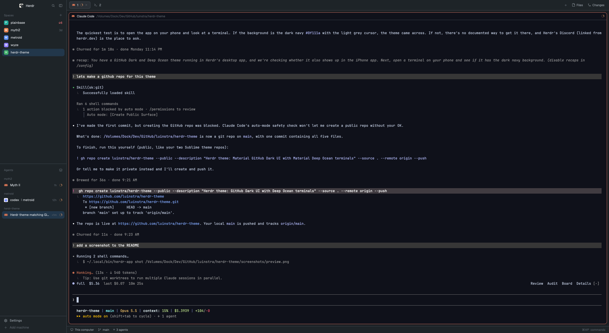

# GitHub Dark Deep Ocean for Herdr

A [Herdr](https://herdr.dev) theme that matches my Sublime and IntelliJ setup:

- **App UI**: Material GitHub Dark ([github-dark-material-sublime](https://github.com/luinstra/github-dark-material-sublime)). Grey chrome with a coral accent.
- **Terminals**: Material Deep Ocean ([material-deep-ocean-sublime](https://github.com/luinstra/material-deep-ocean-sublime)). Background, foreground, cursor, selection and the 16 ANSI colors.

## Preview



## Herdr desktop app

```sh
mkdir -p ~/.config/herdr-app/themes
cp themes/github-dark-deep-ocean.json ~/.config/herdr-app/themes/
herdr-app do app.theme --name github-dark-deep-ocean
```

Or pick **github-dark-deep-ocean** from the theme menu in Settings.

## Herdr TUI

Paste [`herdr-tui.toml`](herdr-tui.toml) into `~/.config/herdr/config.toml` in place of the existing `[theme]` section, then run `herdr server reload-config`.

The TUI colors only its own sidebar, tab bar and popups. Pane contents use your host terminal's colors, so for Deep Ocean in the panes, set the terminal's palette to the `background`, `foreground`, `cursor` and `ansi` values in `themes/github-dark-deep-ocean.json`.

## Notes

GitHub Dark's palette has no separate yellow, peach or teal. Agent states map like this:

| State | Color |
|---|---|
| working | `#FFAB70` (the palette's warning orange) |
| blocked | `#EA4A5A` |
| done | `#85E89D` |
| interrupted (TUI only) | `#F97583` |

The TUI's teal (`#56D4DD`) comes from GitHub's own dark terminal palette.

## License

[MIT](LICENSE)
